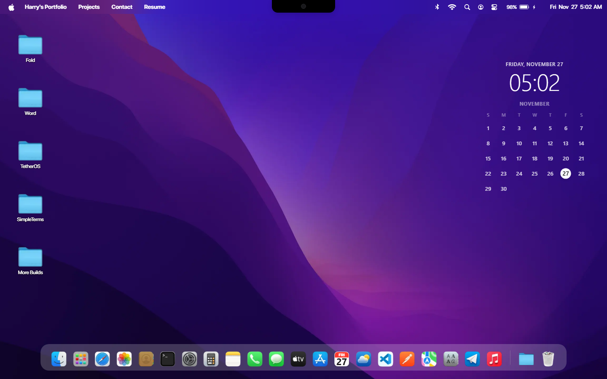
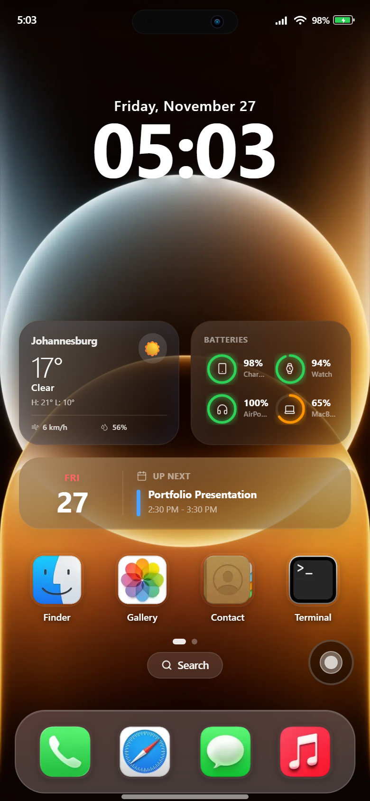

# Harry Koena Mofoka — macOS Portfolio

> **“A builder at heart, with heart, for the heart of it.”**

An interactive macOS-inspired desktop and iOS-inspired mobile portfolio for **Harry Koena Mofoka** — self-taught South African software developer, product builder, and co-founder of **Nexlink Solutions ZA**.



<p align="center">
  
</p>

## Highlights

- **Dual Desktop & Mobile OS Experience**: Full macOS window manager, Dock, Menu Bar, Control Center, Spotlight/Siri assistant, and responsive iOS home screen with live widgets.
- **Flagship Projects Workspace (Finder, Safari, VS Code & Postman)**:
  - **Fold** — Privacy-first, zero-cloud PDF workspace ([foldpdf.vercel.app](https://foldpdf.vercel.app))
  - **Word** — Trust-first P2P stablecoin payment system with 563 automated tests ([word-dusky.vercel.app](https://word-dusky.vercel.app))
  - **TetherOS** — Offline-first second-brain & AI accountability OS ([tether-os-nine.vercel.app](https://tether-os-nine.vercel.app))
  - **SimpleTerms** — AI contract explainer powered by Google Gemini ([simple-terms-ten.vercel.app](https://simple-terms-ten.vercel.app))
  - **Little Stars Preschool** — Early childhood development management & LMS platform
  - **TapShare / Scanned**, **Kalm-LMS**, **anyResume-AI**, **GlowLink**, **VeloriQ**, **BioNex-LIMS**, and **TinyHabits**
- **Interactive Developer Apps**:
  - **Terminal** (`about`, `story`, `nexlink`, `projects`, `techstack`, `contact`, `help`)
  - **VS Code** & **Postman** pre-loaded with Harry's real projects, architecture notes, and endpoints
  - **Built-in CV Viewer** rendering `public/documents/resume.pdf` with download support
  - **South African Localization**: Live weather & Maps favorites for Johannesburg, De Deur / Sedibeng, Pretoria, and Cape Town, plus SAST clock and real GitHub stats (`@HarryMofoka`)
- **Voice & Text Siri Assistant**: Offline fallback knowledge base covering Harry's background, education (General Smuts High School, Sedibeng TVET College, WeThinkCode_), Nexlink Solutions ZA, skills, and projects, with optional Groq API integration.

## Tech Stack

- **Framework**: Next.js 16 (App Router) + React 19
- **Styling & Motion**: Tailwind CSS v4, GSAP, Lucide Icons
- **State & Media**: Zustand, `react-pdf`, Leaflet Maps, Jamendo Music API, Open-Meteo Weather API
- **Quality Gates**: ESLint, Prettier, Husky (`pre-commit` lint-staged & `pre-push` check + production build)

## Unlocking the Portfolio

On the lock screen, enter the current 4-digit year (e.g. `2026`) or click **Unlock** / **Use Touch ID** to enter the desktop immediately.

## Local Development

```bash
npm install
npm run dev
```

Open [http://localhost:3000](http://localhost:3000).

### Useful Scripts

```bash
npm run dev         # Start development server
npm run build       # Production build
npm run start       # Serve production build
npm run lint        # Run ESLint
npm run format      # Format codebase with Prettier
npm run validate    # Format check + lint + production build
```

### Optional Environment Variables

Copy `.env.example` to `.env.local` if you want to enable optional live integrations:

- `GROQ_API_KEY` — Enables LLM responses in the Siri assistant (falls back to built-in local knowledge automatically)
- `NEXT_PUBLIC_JAMENDO_CLIENT_ID` — Custom Jamendo client ID for the Music app
- `NEXT_PUBLIC_SITE_URL` — Canonical deployment URL for SEO / Open Graph metadata

## Contact & Links

- **Portfolio**: [harrymofoka.co.za](https://harrymofoka.co.za)
- **GitHub**: [github.com/HarryMofoka](https://github.com/HarryMofoka)
- **LinkedIn**: [linkedin.com/in/harry-mofoka](https://www.linkedin.com/in/harry-mofoka)
- **Nexlink Solutions ZA**: [nexlinksolutionsza.co.za](https://nexlinksolutionsza.co.za)
- **Email**: [mofokaharry@gmail.com](mailto:mofokaharry@gmail.com)
